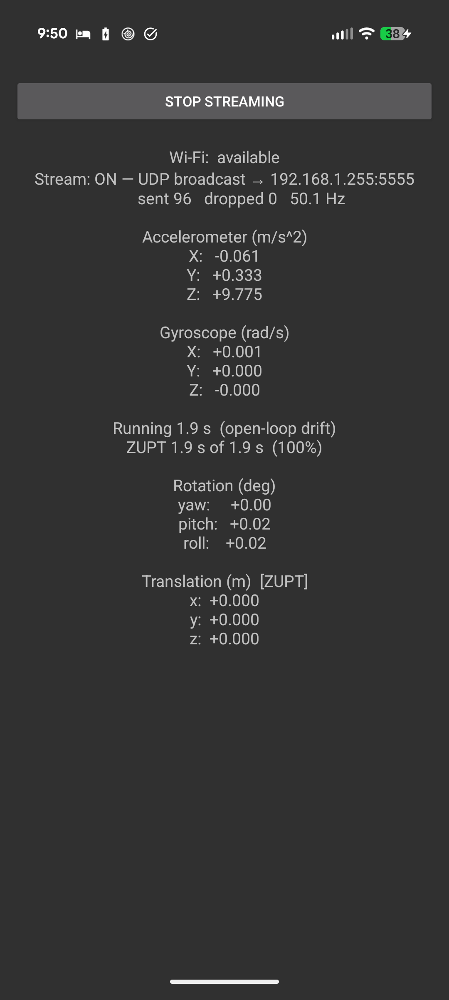
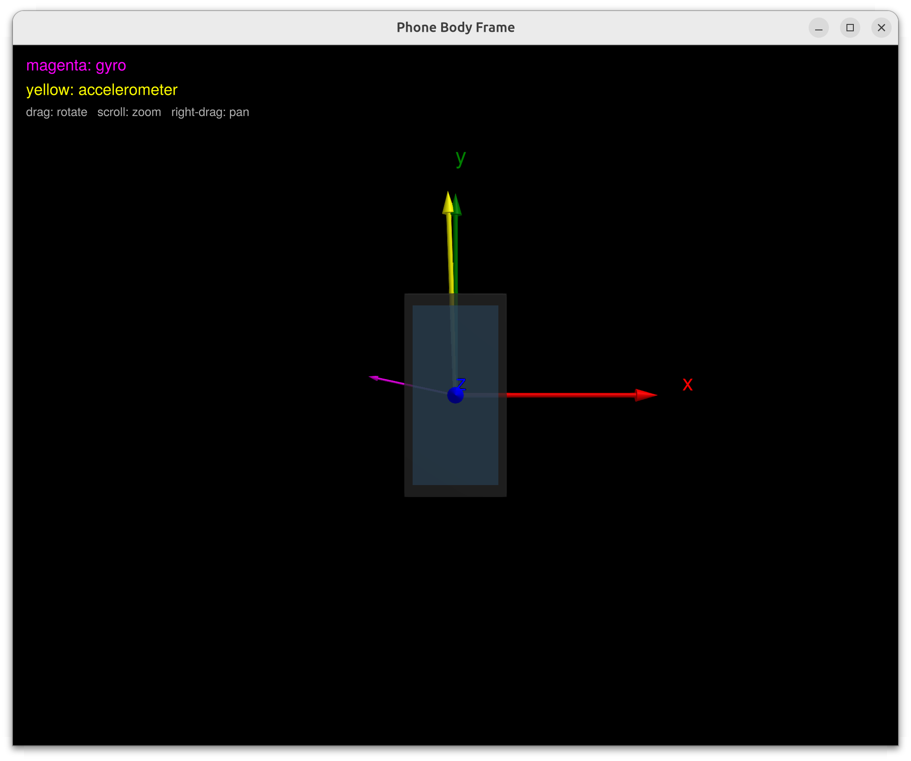

# imu_deadreckoning

**A real-time strapdown inertial dead-reckoning system on a smartphone.** An
Android app streams a phone's gyro + accelerometer over the LAN; a Julia 3-D
viewer decodes and renders the body frame live. On the phone, a from-scratch
strapdown mechanization integrates the IMU into a relative pose $\Delta\mathbf{T} \in \mathrm{SE}(3)$,
with fixed-gravity compensation and a zero-velocity update (ZUPT) — no bias
correction and no aiding.

It is deliberately **open-loop** — the inertial *front-end* of an INS/VIO, with
no camera or GPS aiding. The point is to build the mechanization correctly from
the math and to be honest about exactly why, and how fast, pure inertial
navigation drifts.

```
  ┌─────────────────────────┐   ImuBatch  · UDP :5555   ┌───────────────────────────────────┐
  │  Android: SensorLogger  │ ─────────────────────────►│ body.jl  — body-frame (IMU)       │
  │  gyro + accel @ ~50 Hz  │                           │ gyro / accel arrows               │
  │  Integrator → ΔT ∈ SE(3)│   PoseBatch · UDP :5556   │ world.jl — world-frame (pose)     │
  │                         │ ─────────────────────────►│ ΔT + breadcrumbs + trail          │
  └─────────────────────────┘                           └───────────────────────────────────┘
        shared schema:  msgs/*.proto   (single source of truth, all languages)
```

---

## IMU measurements

What the phone actually hands us: `Sensor.TYPE_GYROSCOPE` and
`Sensor.TYPE_ACCELEROMETER` at ~50 Hz, both expressed in the **Android sensor
frame** — the body frame $b$: $+x$ out the right edge of the screen, $+y$ out
the top edge, $+z$ out of the glass, right-handed, fixed to the device (it does
**not** follow screen auto-rotation). See the
[Android IMU notebook](https://github.com/RickASprague/gh_notebooks/blob/master/other/android_imu.ipynb)
for the frame definition and sign conventions.

Neither sensor reports the ideal kinematic quantity — each measurement carries
a bias and noise:

$$
\tilde{\boldsymbol{\omega}}^b = \boldsymbol{\omega}^b_{wb} + \mathbf{b}_\omega + \mathbf{n}_\omega
\qquad\qquad
\tilde{\mathbf{f}}^b = \mathbf{R}^b_w\left(\mathbf{a}^w - \mathbf{g}^w\right) + \mathbf{b}_a + \mathbf{n}_a
$$

- **Gyro** — body angular rate (rad/s) plus a slowly wandering bias $\mathbf{b}_\omega$
  and white noise $\mathbf{n}_\omega$.
- **Accelerometer** — **specific force**, not acceleration: the kinematic
  acceleration minus gravity, rotated into the body frame, plus bias $\mathbf{b}_a$
  and noise $\mathbf{n}_a$. Gravity is *in* the measurement — at rest, flat on a
  table ($+z$ up), it reads $\approx (0, 0, +9.81)$ m/s²: the reaction to
  gravity, not motion.

The mechanization below consumes exactly these two signals, raw — $\mathbf{b}_\omega$
and $\mathbf{b}_a$ stay in.

## The estimation content

The heart is `SensorLogger/app/.../Integrator.java` — a strapdown mechanization
accumulating the relative pose from a captured start frame:

$$
\Delta\mathbf{T} = \begin{bmatrix} \mathbf{R}^w_b & \mathbf{p}^w \\
\mathbf{0}^\top & 1 \end{bmatrix} \in \mathrm{SE}(3)
$$

**Orientation — on the manifold.** Raw gyro $\boldsymbol{\omega}^b_{wb}$ (no bias removal) integrates on $\mathrm{SO}(3)$ via the exact
matrix exponential (Rodrigues), not an Euler-angle or first-order hack:

$$
\mathbf{R}^w_b \leftarrow \mathbf{R}^w_b\ \mathrm{Exp}(\boldsymbol{\omega}^b_{wb}\ \Delta t),\qquad
\mathrm{Exp}(\boldsymbol{\phi}) = \mathbf{I} + \frac{\sin\theta}{\theta}[\boldsymbol{\phi}]_\times + \frac{1-\cos\theta}{\theta^2}[\boldsymbol{\phi}]_\times^2,\qquad
\theta = \lVert\boldsymbol{\phi}\rVert
$$

Each increment is orthonormal to machine precision, so $\mathbf{R}$ stays on $\mathrm{SO}(3)$ — no
re-orthonormalization needed in double precision.

**Translation — 2nd-order.** The accelerometer's specific force is rotated to the
world frame, a fixed gravity $\mathbf{g}^w = (0,0,-g)$ added (not measured — assumed,
with the start frame taken level), and double-integrated. The scheme is the exact
first-order-hold integral (≡ velocity Verlet in the velocity step):

$$
\begin{aligned}
\mathbf{a}^w &= \mathbf{R}^w_b\ \mathbf{f}^b + \mathbf{g}^w\\
\mathbf{p}^w &\leftarrow \mathbf{p}^w + \mathbf{v}^w\ \Delta t + \frac{2\mathbf{a}^w_n + \mathbf{a}^w_{n+1}}{6}\ \Delta t^2\\
\mathbf{v}^w &\leftarrow \mathbf{v}^w + \tfrac{1}{2}(\mathbf{a}^w_n + \mathbf{a}^w_{n+1})\ \Delta t
\end{aligned}
$$

**No calibration.** There is deliberately no static-init hold and no bias
estimation: the gyro is integrated **raw** (no $\mathbf{b}_\omega$ removal), gravity is **not
measured** but assumed fixed at $\mathbf{g}^w = (0,0,-g)$ with the start frame taken level
(phone flat, screen up), and the accelerometer bias is left in — it is
unobservable from a single static pose anyway. Integration begins on the first
sample after *Start*. The only thing bounding the resulting drift is the ZUPT
below.

**ZUPT (zero-velocity update).** A stationarity detector ($\lVert\boldsymbol{\omega}^b_{wb}\rVert$ small and $\lVert\mathbf{f}\rVert \approx g$)
clamps $\mathbf{v} \leftarrow \mathbf{0}$ and holds position while the device is still — severing the
bias/tilt → velocity → position drift ramp. On a table, position stops
wandering.

Small linear-algebra helpers (skew/hat, `expSO3`, 3×3 mat ops, Euler
extraction) live in `Utils.java`.

## Honest limitations — and the theory

Pure inertial dead reckoning **drifts**, and it's worth being precise about why:

- **Orientation** is a single integral of the rate → a **linear ramp** from the
  uncorrected gyro bias, plus a $\sqrt{t}$ random walk from noise. (Removing the
  bias would leave only the slow $\sqrt{t}$ term — but we don't, here.) **Yaw is
  the weak axis** — gravity anchors roll/pitch but says nothing about heading.
- **Translation** is a *double* integral of a *biased* signal → runs away as
  $\mathcal{O}(t^2)$. A residual accel bias $\mathbf{b}_a$ gives $`\Delta\mathbf{p} \approx \tfrac{1}{2}\mathbf{b}_a t^2`$; a tilt error $\delta\theta$
  leaks gravity as $`a_\text{leak} \approx g\ \delta\theta \approx 9.81\ \delta\theta`$, so even 0.5° of tilt →
  ~0.085 m/s² → ~4 m in 10 s. Consumer-MEMS bias instability is large; the
  9.81× gravity amplifier is why great gyro still can't rescue position.
- **Filtering the gyro doesn't help the drift.** The drift is low-frequency
  (bias/random-walk); a low-pass passes low frequencies, and integration
  already attenuates the high-frequency noise it would remove. What helps is
  *bias removal* (not done here — the gyro and accel run raw) and *fusion* — not
  smoothing.

**Future:**

Rather than spend time polishing, the next step is Kalman filter tracking and
rudimentary visual odometry.

Cursory static-bias experiments were done and were in fact promising: a 1 s
static calibration (phone flat on the table) measuring the gyro and
accelerometer biases noticeably slows the drift. But static calibration, while
nice, is deficient — the biases wander (bias instability, temperature), so a
one-shot estimate decays. The real gains are in sensor fusion: fuse the IMU
with other inputs — e.g. visual-odometry ego-motion — in a filter that carries
the biases as states, so external measurements update them dynamically and
continuously.

---

## Components

| Dir | What |
|-----|------|
| `msgs/` | protobuf schema — single source of truth for all languages. `imu/` (ImuSample, ImuBatch), `linalg/` (Vec3f, Vec3d, Mat4f), `pose/` (PoseSample, PoseBatch). |
| `SensorLogger/` | Android app (Java). Reads gyro/accel, runs `Integrator`, broadcasts `ImuBatch` over UDP. Single-screen UI: live IMU readout + streaming toggle (Wi-Fi LAN only, never cellular). |
| `SensorLoggerViewer/` | Julia app. `body.jl` — 3-D **body-frame** viewer of the raw IMU (magenta gyro / yellow accel vectors) on `ImuBatch` (5555). `world.jl` — 3-D **world-frame** viewer of the integrated pose on `PoseBatch` (5556): the body triad moving off a fixed home/table, with a breadcrumb triad dropped every second and a position trail. |

<p align="center">
  
</p>

*The SensorLogger app streaming: UDP broadcast to `192.168.1.255:5555` at
~50 Hz, live accel/gyro readout (phone flat — $`\mathbf{f}^b`$ ≈ +9.78 m/s² on
z), the integrated rotation/translation, and the ZUPT holding position while
the phone sits still (engaged 100% of the run).*

<p align="center">
  
</p>

*`body.jl` displays the raw gyro rate $`\boldsymbol{\omega}^b_{ib}`$ (magenta) and
specific force $`\mathbf{f}^b`$ (yellow) live as soon as the app's **streaming**
toggle is pressed — no calibration or warm-up. Here the phone is standing
upright: $`\mathbf{f}^b`$ reads the reaction ≈ g along body +y and the gyro is
near zero.*

## Transport

Plain **UDP broadcast** on the local subnet — no framing. Two independent
streams on two ports, so a consumer subscribes to whichever it needs:

| Port | Message | Producer | Consumer |
|------|---------|----------|----------|
| 5555 | `ImuBatch`  | `ImuPublisher`  | `body.jl` |
| 5556 | `PoseBatch` (ΔT as `Mat4f`) | `PosePublisher` | `world.jl` |

Connectionless and lossy by design: each sample self-timestamps (`t_mono_ns`),
so a dropped datagram just widens an integration interval — and each `PoseSample`
carries the *absolute* ΔT-from-start, so a lost pose datagram needs no resync.
The viewers bind `0.0.0.0` (a socket bound to a specific unicast address does
*not* receive subnet-broadcast on Linux).

Each batch carries a `seq` counter. `ImuBatch.seq` is **monotonic for the whole
producer process** — the raw sensor feed never "restarts". `PoseBatch.seq`
**resets to 0 on each new streaming session** (ΔT back at identity); `world.jl`
watches for `seq == 0` (or a large backward jump, if that datagram was lost) and
clears its trail/breadcrumbs so a new session starts clean at home — no phantom
line from the old drift point back to the origin.

## Build & run

Dev environment via Nix (`nix develop` — provides `protoc`, JDK, Julia + GL).

### One-shot: CMake orchestrator

The root `CMakeLists.txt` is a thin driver (no C++ — `LANGUAGES NONE`) over both
heterogeneous builds. It regenerates the Julia bindings (ProtoBuf.jl) and
assembles the Android APK (Gradle), each wired to its real inputs (the
`msgs/*.proto` schema, plus the Java sources for the APK) so a rebuild only fires
when those change.

```bash
cmake -S . -B build -G Ninja
cmake --build build                          # both: julia_proto + sensorlogger
cmake --build build --target julia_proto     # just the Julia bindings
cmake --build build --target sensorlogger    # just the Android APK
cmake --build build --target install-apk     # adb install -r  (opt-in)
```

Useful configure options:

| Option | Default | Effect |
|--------|---------|--------|
| `-DIMU_BUILD_JULIA_PROTO=OFF` | `ON` | skip the Julia binding generation |
| `-DIMU_BUILD_ANDROID=OFF` | `ON` | skip the Android APK (no SDK needed) |
| `-DIMU_ANDROID_VARIANT=Release` | `Debug` | `:app:assembleRelease` instead of Debug |
| `-DIMU_JULIA_CHANNEL=""` | `1.11` | juliaup channel for `julia +<channel>` (empty = default `julia`) |

The Android half still needs the Android SDK (`SensorLogger/local.properties` →
`sdk.dir`); the Julia half needs `julia` on `PATH`.

### Or drive each build directly

**Android** (needs the Android SDK, e.g. via Android Studio):
```bash
cd SensorLogger
./gradlew :app:assembleDebug
adb install -r app/build/outputs/apk/debug/app-debug.apk
```
Open the app → **Start streaming** (integration begins immediately — no
calibration — and it reads out rotation/translation live).

**Julia viewer** (Julia 1.11 via juliaup):
```bash
cd SensorLoggerViewer
julia +1.11 --project=. gen_proto.jl        # regenerate protobuf bindings
julia +1.11 -t 3 --project=. body.jl        # body-frame IMU viewer   (ImuBatch, 5555)
julia +1.11 -t 3 --project=. world.jl       # world-frame pose viewer (PoseBatch, 5556)
```

Both decode the same `msgs/` schema; the Julia bindings are generated by
ProtoBuf.jl (`gen_proto.jl`), the Java bindings by the Gradle protobuf plugin —
no hand-written schema copies.
