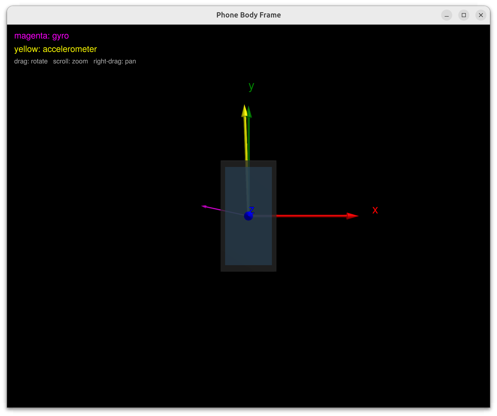

# SensorLoggerViewer

Julia viewers for the Android **SensorLogger** app's two UDP-broadcast streams.
Each binds `0.0.0.0` on its port and decodes one protobuf message per datagram
(no ZMQ, no framing).

| Viewer | Port | Message | Shows |
|--------|------|---------|-------|
| `body.jl`  | 5555 | `vslam.msgs.ImuBatch`  | **body frame** — phone fixed at the origin, live gyro (magenta) / accel (yellow) arrows. |
| `world.jl` | 5556 | `vslam.msgs.PoseBatch` | **world frame** — the integrated pose ΔT carrying the body triad off a fixed home/table, a breadcrumb triad dropped every second, and a position trail. |

<p align="center">
  
</p>

*`body.jl` displays the raw gyro rate $`\boldsymbol{\omega}^b_{ib}`$ (magenta) and
specific force $`\mathbf{f}^b`$ (yellow) live as soon as the app's **streaming**
toggle is pressed — no calibration or warm-up. Here the phone is standing
upright: $`\mathbf{f}^b`$ reads the reaction ≈ g along body +y and the gyro is
near zero.*

## Run

Julia 1.11 (via juliaup):

```bash
julia +1.11 -t 3 --project=. body.jl  [port]      # default 5555
julia +1.11 -t 3 --project=. world.jl [port]      # default 5556
```

First run resolves deps from `Project.toml`/`Manifest.toml`; if needed:
`julia +1.11 --project=. -e 'using Pkg; Pkg.instantiate()'`.

## Generating the Julia protobuf bindings

The message schema is the single source of truth in the repo-root `msgs/` tree
(`msgs/imu/imu.proto`, `msgs/pose/pose.proto`, `msgs/linalg/linalg.proto`) —
shared with the Android (Java) codegen. The Julia bindings under `proto_gen/`
are **generated, not hand-written**; regenerate them whenever a `.proto`
changes:

```bash
julia +1.11 --project=. gen_proto.jl
```

`gen_proto.jl` drives **ProtoBuf.jl's own generator** (`protojl`) — it parses the
`.proto` files directly, it does *not* go through `protoc`. Add any new `.proto`
to the `PROTOS` list in that script. ProtoBuf.jl mirrors the proto `package
vslam.msgs` as a nested module tree:

```
proto_gen/vslam/vslam.jl           # top module
proto_gen/vslam/msgs/msgs.jl       # module vslam.msgs
proto_gen/vslam/msgs/linalg_pb.jl  # Vec3f, Vec3d, Mat4f
proto_gen/vslam/msgs/imu_pb.jl     # ImuSample, ImuBatch
proto_gen/vslam/msgs/pose_pb.jl    # PoseSample, PoseBatch
```

Type mapping: `float → Float32`, `double → Float64`, `int64 → Int64`,
`repeated → Vector`, optional message → `nothing` when unset.

Load the generated code (as `body.jl` / `world.jl` do):

```julia
include(joinpath(@__DIR__, "proto_gen", "vslam", "vslam.jl"))
using .vslam.msgs: ImuBatch, PoseBatch
import ProtoBuf as PB
batch = PB.decode(PB.ProtoDecoder(IOBuffer(bytes)), PoseBatch)
```
